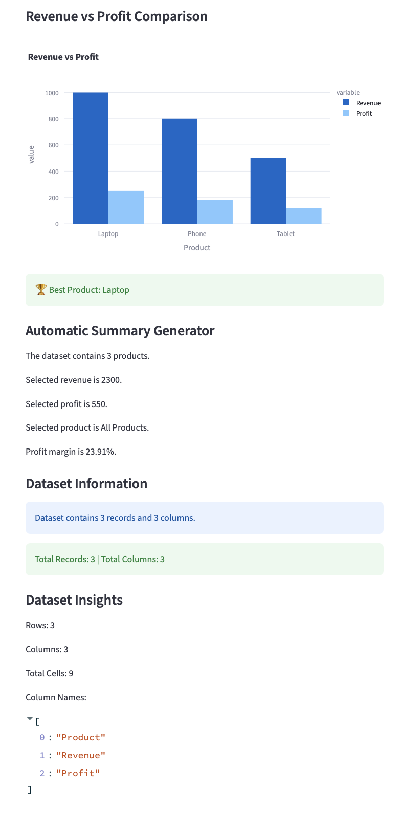
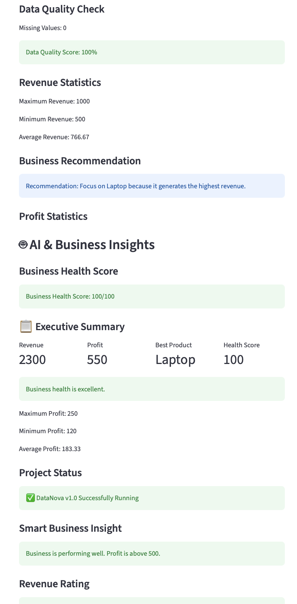
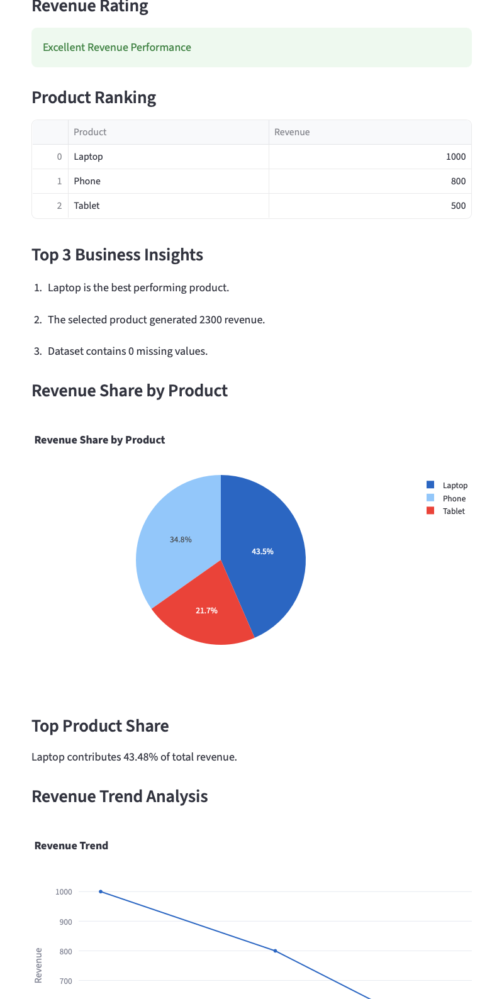

# DataNova

AI-Powered Business Analytics Dashboard built with Python, Pandas, Plotly and Streamlit.

## Current Version

DataNova v5.0

Dashboard Screenshots

Dashboard Overview & Data Upload

KPI Dashboard & Revenue Analytics

Revenue vs Profit Comparison

Executive Summary & AI Business Insights

Product Ranking, Revenue Share & Trend Analysis

Revenue Forecasting & AI Business Advisor

## Features

- CSV Upload
- Excel Upload
- Excel Sheet Selector
- Product Search
- Product Filter
- KPI Dashboard
- Revenue Analysis
- Profit Analysis
- Revenue vs Profit Comparison
- Revenue Share Pie Chart
- Revenue Trend Analysis
- Revenue Trend Insight
- Revenue Forecasting
- Data Quality Check
- Business Health Score
- Executive Summary Dashboard
- AI Business Advisor
- PDF Report Export
- Download Filtered Data
- Streamlit Cloud Deployment

## Technologies

- Python
- Pandas
- Streamlit
- Plotly
- ReportLab
- Git
- GitHub

## Use Cases

- Business Performance Monitoring
- Revenue Analysis
- Profit Analysis
- Data Quality Monitoring
- Business Forecasting
- KPI Reporting

## Future Roadmap

- Machine Learning Forecasting
- Sidebar Navigation
- Advanced Filtering
- Enhanced Dashboard Design
- AI Analytics Assistant
