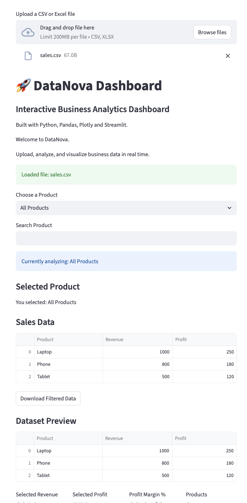
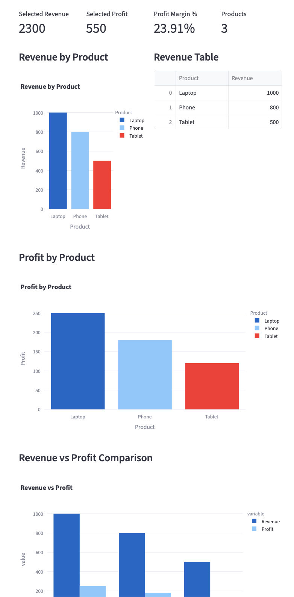
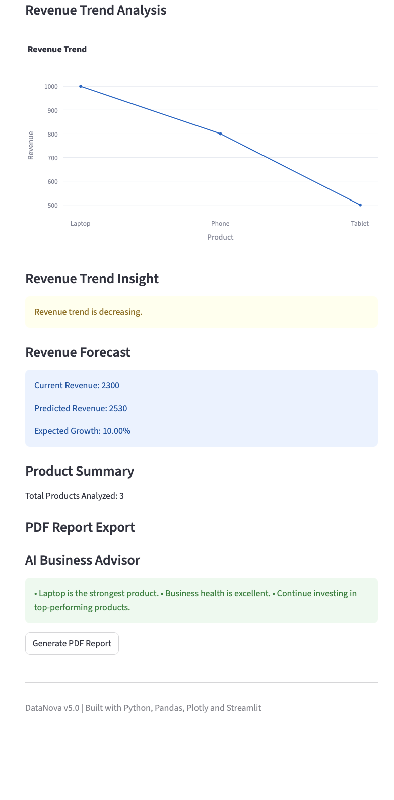

# DataNova
AI-Powered Business Analytics Platform

AI-Powered Business Analytics Platform that combines Business Intelligence, Machine Learning Forecasting, Executive Reporting, and AI-driven Decision Support.

Built with Python, Pandas, Plotly, Streamlit, Scikit-Learn, and ReportLab.

## Current Version

DataNova v7.5

Project Structure
📊 Dashboard
🤖 Machine Learning
📈 Forecast Center
🤖 AI Assistant

Machine Learning Models
Linear Regression
Random Forest Regressor
Decision Tree Regressor
DataNova compares model performance and identifies the most accurate model automatically.

Forecast Center
Features:

Executive Forecast Summary
Forecast Revenue Prediction
Confidence Score
Model Leaderboard
AI Recommendation Engine
Executive Decision Support
Forecast Report Export

AI Assistant
Ask DataNova business questions such as:

What is my best product?
Which model is most accurate?
What is the forecast revenue?
Should I increase investment?
What is my business health?

Current Capabilities
✅ Interactive Dashboard

✅ Multi-Model Forecasting

✅ Executive Forecast Reports

✅ AI Business Insights

✅ AI Assistant

✅ KPI Analytics

✅ CSV & Excel Processing

✅ Business Health Scoring

Future Roadmap
✅ Forecast Center ✅ AI Assistant ✅ Multi-Model Forecasting

Upcoming
Real PDF Forecast Reports
Enhanced AI Assistant
Natural Language Queries
Advanced Dashboard Design
Multi-Dataset Forecasting
AI Business Copilot

Project Highlights
4 Navigation Pages
3 Machine Learning Models
AI Business Assistant
Executive Reporting System
Interactive Business Dashboard
Forecast Recommendation Engine

Installation
Clone the repository:

git clone YOUR_REPOSITORY_URL

Dashboard Screenshots

Dashboard Overview & Data Upload

KPI Dashboard & Revenue Analytics

Revenue vs Profit Comparison

Executive Summary & AI Business Insights

Product Ranking, Revenue Share & Trend Analysis

Revenue Forecasting & AI Business Advisor

New Features Screenshots (Coming Soon)
Forecast Center
AI Assistant
Executive Forecast Summary
Model Leaderboard

## Features

- CSV Upload
- Excel Upload
- Excel Sheet Selector
- Product Search
- Product Filter
- KPI Dashboard
- Revenue Analysis
- Profit Analysis
- Revenue vs Profit Comparison
- Revenue Share Pie Chart
- Revenue Trend Analysis
- Revenue Trend Insight
- Data Quality Check
- Business Health Score
- Executive Summary Dashboard
- AI Business Advisor
- PDF Report Export
- Download Filtered Data
- Streamlit Cloud Deployment
- Business Dashboard
- Machine Learning Forecasting
- Linear Regression
- Random Forest
- Decision Tree
- Executive Forecast Summary
- AI Recommendations
- Forecast Reports
- AI Business Assistant

## Technologies

- Python
- Pandas
- Streamlit
- Plotly
- ReportLab
- Git
- GitHub
- Scikit-Learn
## Use Cases

- Business Performance Monitoring
- Revenue Analysis
- Profit Analysis
- Data Quality Monitoring
- Business Forecasting
- KPI Reporting
